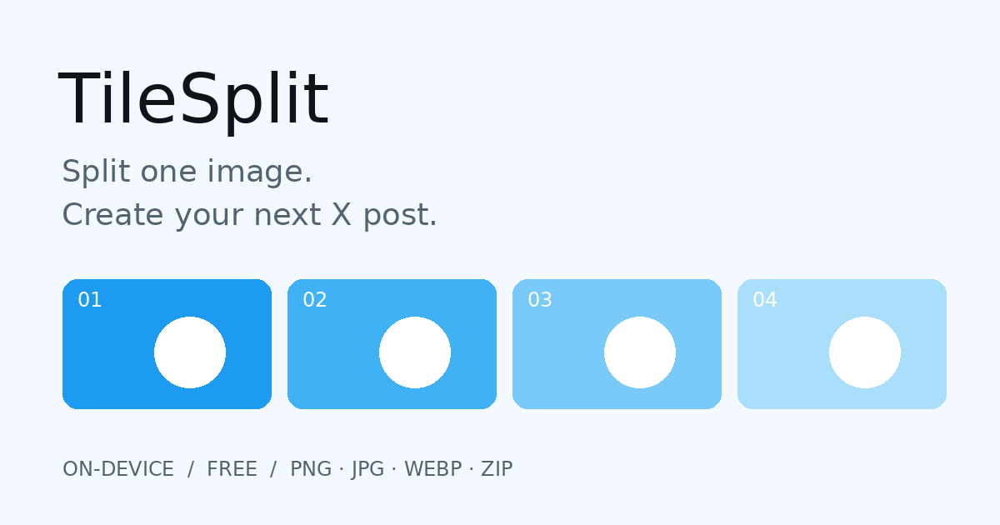

# TileSplit

画像を縦方向に分割して、X投稿用の連続画像を作る無料のブラウザツールです。

**[ツールを開く](https://crystar-studio.github.io/tile-split/)**

## 使い方

1. 画像を選択、ドラッグ＆ドロップ、または貼り付けます。
2. 分割数を選びます（2〜100枚）。分割線はドラッグで調整できます。
3. 必要に応じてTLの隙間補正を切り替え、PNG・JPG・WebPから保存形式を選びます。
4. 「分割画像を作成」を押し、ZIPまたは個別ファイルで保存します。
5. Xでファイル名の番号順に画像を選び、投稿前に表示を確認します。

分割線にフォーカスし、← →で1px、Shift併用で10px移動できます。一度線を選ぶとTab / Shift+Tabで隣の線へ移れます。

## Xへの投稿とスマートフォンでの保存

- プレビューは横並び表示の目安です。Xの表示・投稿上限はアカウント、アプリ、端末、仕様変更によって異なります。20枚投稿やシームレスな表示を保証するものではありません。
- 隙間補正は幅249px・間隔2pxの表示を仮定した概算です。
- スマホでは対応ブラウザの共有メニューから保存先を選べます。共有非対応の場合はファイルのダウンロードになります。写真アプリへの保存や並び順はOS・アプリに依存します。
- 連続ダウンロードがブロックされる場合はZIP保存、またはサムネイルから1枚ずつ保存してください。
- JPGは透明部分を白にします。WebPの受け入れ可否は投稿先で確認してください。
- 大きい画像や大量分割は端末のメモリを使います。失敗する場合は画像サイズや分割数を減らしてください。

## プライバシー

画像の読み込み・加工・ZIP生成は端末のブラウザ内で完結します。画像のアップロード、解析ツール、外部CDN、外部フォントはありません。言語、分割数、形式、隙間補正の設定だけをlocalStorageに保存します。

サイト配信自体にはGitHub Pagesを使用します。[GitHubのプライバシーステートメント](https://docs.github.com/ja/site-policy/privacy-policies/github-general-privacy-statement)も参照してください。

## 不具合報告

[Issues](https://github.com/crystar-studio/tile-split/issues)に、ブラウザ・OS・再現手順・画像のサイズ・分割数を記載してください。機密画像や個人情報を含む画像は添付しないでください。